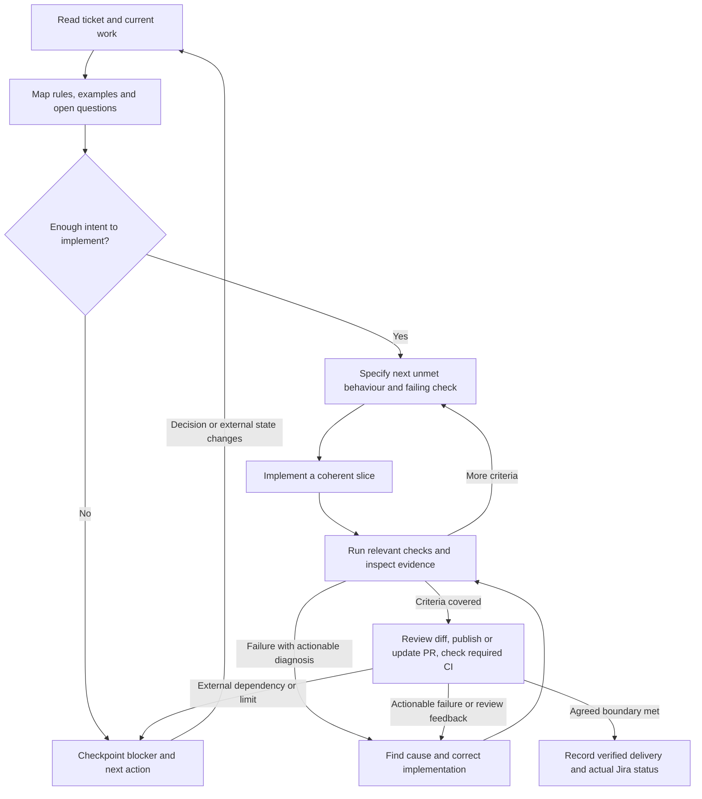

# Ticket delivery loop

The unit of work is a selected ticket and its agreed delivery boundary. For a bounded batch, record the selected keys once, order known dependencies, and work through that set. Do not continually expand a query to ingest new work unless the user requested an ongoing queue.

## Entry and state

Start from an explicit request to deliver or resume selected tickets, or a trusted runner dispatch configured for that purpose. Record the ticket snapshot, repository, existing branch/PR, available tools, authorized side effects and acceptance evidence. Discover existing work before creating another branch or PR. Respect another worker's active ownership; isolated worktrees can prevent accidental overlap when available.

Use these internal delivery states; they are not Jira status names:

At each iteration, retain the criterion being addressed, the hypothesis or next operation, changed artifacts, observed result and remaining work. Continue when another criterion or actionable failure exists. Checkpoint after meaningful progress so a session boundary does not discard state.

## BDD implementation cycle

1. Identify the next unsatisfied rule and scenario. Establish the current behaviour; distinguish existing failures from the requested change.
2. Make the scenario executable at a relevant boundary. Confirm it fails for the expected behavioural reason, not missing infrastructure or a broken test setup. Existing passing coverage can be reused if it really proves the criterion.
3. Implement the smallest coherent slice and run the focused scenario plus affected regression checks. Do not change the expected result to match incorrect code.
4. If a check fails, investigate the cause before another change. Correct an implementation defect; resolve a genuine requirement contradiction with the decision-maker and then update its scenarios. Preserve the distinction in the record.
5. Once the scenario passes, refactor within scope while retaining evidence. Continue with the next criterion and then the relevant full suite, diff review and PR checks.

Tests written by the same agent can repeat its misunderstanding. Compare them with ticket rules, concrete examples and existing independent contract tests. Review missing negative cases and assertions that merely mirror internal implementation. A pending, undefined, skipped or manually reviewed scenario is not an executed pass.

## Completion and truthful status

The default agent delivery boundary is verified implementation plus a review-ready PR. It requires every in-scope criterion mapped to evidence, no unresolved relevant failures, applicable local checks, required CI success at the current PR revision, and a diff reviewed for scope and correctness. The PR must describe the ticket, behaviour and evidence and be ready for human review rather than left as a draft. If no required CI exists, record that fact instead of inventing a gate.

Project Definition of Done and Jira status can require more. A ticket awaiting human review, merge, release or business acceptance must be reported that way even when the agent's requested delivery boundary is met. Do not merge, deploy or close it merely to align a status label with the agent's success. If the user requested a stricter boundary, continue through the authorized stages that tools permit; an external gate remains an explicit pending dependency.

When current CI is pending, use an available completion notification or bounded check with suitable backoff. If the environment cannot wait or resume automatically, checkpoint as waiting rather than declaring success or promising background monitoring. Address current review feedback when it is part of the run, and revalidate after edits.

## Progress, retries and resumption

- Productive changes and new evidence may continue for as many iterations as the task needs within actual session/tool budgets. Do not stop after an arbitrary number of successful slices.
- Repeating the same failing action with unchanged inputs is not progress. Use the runner's retry policy; absent one, allow at most three retries for a clearly transient error, honouring server backoff. Permission errors, missing decisions and deterministic failures need resolution rather than repeated requests.
- An uncertain external write must be reconciled by reading current state before retry. Never create duplicate PRs or ticket comments because a response was lost.
- On a concrete blocker, record its cause, attempted remedies, remaining criterion, required decision or external event, and exact resume point. Continue independent authorized work on other selected tickets if useful.
- On resumption, refresh ticket and repository state, compare with the checkpoint and invalidate evidence affected by newer changes. Reuse unchanged completed work. Cancelled or reassigned work requires reconciliation before further writes.

## Parent and child execution

When supported and permitted, the parent schedules a graph of ready tasks across the selected tickets or independent slices. Children can analyse separate rules, propose scenarios, implement disjoint modules or verify a fixed integrated revision concurrently. Keep scenario acceptance before dependent implementation, and implementation before acceptance checks of that changed behaviour. Do not let speculative scenario drafts redefine the intent while another child implements it.

Use one accountable parent per ticket/run; child agents are members of that run, not additional ticket owners. Each child receives the issue snapshot, criterion IDs, input revision, scoped outputs, file ownership, permitted actions and required evidence. Record task generation and descendants. Separate context windows do not imply separate working directories. Use verified worktree isolation or disjoint write paths and isolated test resources; assign shared files to one writer.

The parent reconciles analysis, accepts scenario mappings, integrates child changes and verifies the combined revision. A child report alone is not proof. If criteria or shared contracts change, stop or steer affected children and invalidate stale results. Parents can run stages of independent slices concurrently; dependent stages join on accepted prerequisites.

Allow nested child coordinators only where available and within the global concurrency/depth budget. Otherwise flatten work under the parent, or execute the same graph sequentially if delegation is unavailable. Check liveness and partial writes before reassigning failed or interrupted work.

Keep PR/Jira publication with the designated parent by default. Children return evidence and proposed updates rather than creating duplicate comments, PRs or transitions. Join or stop all relevant writers before final completion. An optional parallel-stage-orchestration skill supplies the detailed platform matrix and assignment template; this workflow remains usable without it.
