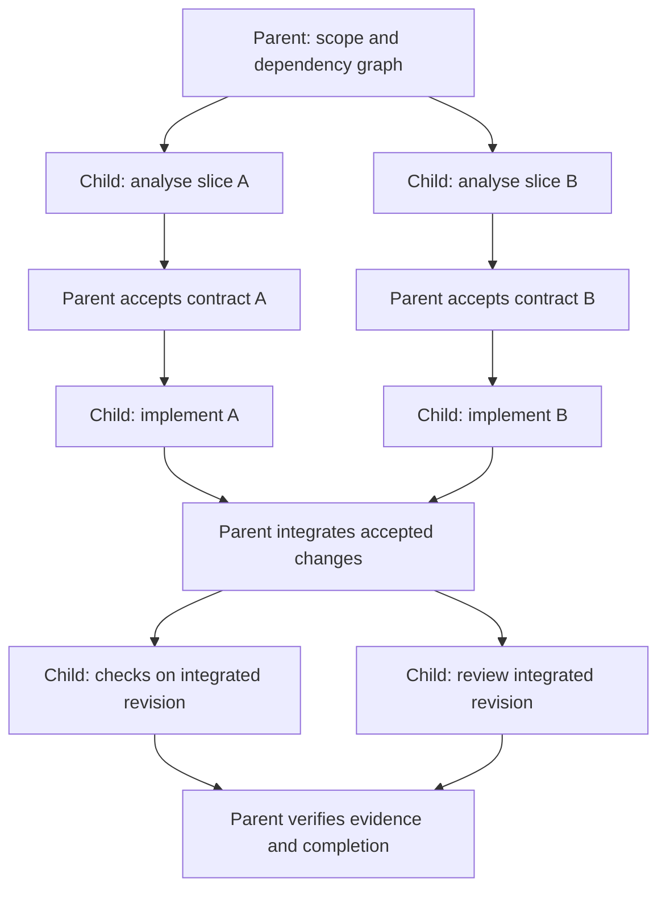

# Scheduling, ownership and integration

Create a dependency graph of stage tasks, with one parent coordinating acceptance. Each task has an ID, input revision, criterion/operation IDs, prerequisites, owner, permitted files or output artifact, status and result location. A stage becomes ready only after its required inputs have been accepted.

## Where parallelism helps

| Work | May run concurrently | Required join |
| --- | --- | --- |
| Requirements and code discovery | Read-only exploration of independent domains, existing contracts and test coverage. | Parent reconciles contradictions before adopting the analysis. |
| REASONS canvas | Proposed sections or independent feature canvases based on agreed inputs. | Single owner integrates a canonical canvas and checks cross-section consistency. |
| BDD scenario discovery | Scenario proposals for independent rules; review of negative cases. | Parent resolves business questions and accepts the criterion mapping before dependent implementation. |
| Implementation | Independent slices with stable interfaces and disjoint ownership or isolated workspaces. | Integrate in dependency order, resolve overlaps, then test the combined tree. |
| Verification | Tests and reviews on an immutable revision with isolated build outputs, ports and test data. | Results must name that revision; rerun checks affected by later changes. |
| Prompt update or code-to-spec sync | Read-only impact analysis across affected components. | One owner updates the canonical requirements/canvas; do not race two writers on acceptance criteria. |

Stages can overlap across slices. Analysis of slice B may run while slice A is implemented only if B cannot invalidate A's accepted requirements or interfaces. Do not launch specification, implementation and acceptance validation of the same unsettled slice together and call them independent.

This graph assumes the slices are independent. Add dependency edges where they share a contract or prerequisite; the parent may serialize writes without abandoning read-only parallel work.

## Dispatch and fan-in

1. Reuse the task graph and current evidence. Select ready tasks and reserve capacity for the parent and required integration. Bound active descendants by the runtime and the user's budget; queue excess work.
2. Send a concrete assignment using [the child assignment](../assets/child-assignment.md). Pass applicable stage instructions and inputs explicitly. Each child must know whether it may edit files or only return findings.
3. Track every child and descendant. The parent may do independent work but must not edit files owned by active writers. A child returns scope problems or blocked dependencies instead of expanding its assignment.
4. Collect structured results and inspect artifacts, diffs and check outcomes. Reject results based on stale input revisions or missing required evidence. Conflicting findings are decisions for the parent, not a majority vote.
5. Integrate accepted changes into the parent-owned branch. Resolve conflicts without discarding other work. A child's clean tests do not cover interactions introduced by integration.
6. Verify the integrated revision and remaining criteria. Stop or join relevant workers before final publication. Record actual external actions once through the designated owner.

Prefer isolated worktrees/branches for parallel writers if the runtime supports them. When the workspace is shared, use non-overlapping file ownership; shared build descriptors and lockfiles need one writer. Tests can also collide through generated files, ports or databases, so partition those resources or serialize the checks.

## Failure, cancellation and recovery

When a child fails, inspect its current state and partial artifacts before retrying. Reuse valid output, change the failing hypothesis, or reassign the task after the former writer has stopped. Apply bounded retries for transient failures; unchanged deterministic failures need diagnosis.

If requirements change, mark affected descendants and their evidence stale. Stop or steer them with the new input revision before accepting results. If a parent loses its session, reconcile recorded child IDs, current branches and remote writes before resuming; do not automatically launch duplicates. Unknown worker liveness blocks reassignment of its write ownership until reconciled.

For runtimes without nested delegation, flatten ready tasks under the parent. For runtimes without delegation at all, the parent executes each ready task and uses the same evidence and completion rules. Do not describe sequential role changes as multiple agents.

## Worked scheduling example

Two tickets change independent reporting and notification modules with no shared interface. The parent can assign one implementation child to each after their criteria are settled, and a read-only reviewer to inspect existing contract coverage. If both later require the same database migration, the parent introduces a shared migration prerequisite owned by one writer and holds dependent implementation until it is accepted.

The parent remains the sole Jira/PR publisher for each ticket. A child returning “done” with no revision or test evidence is a result to inspect, not permission to transition the ticket.
