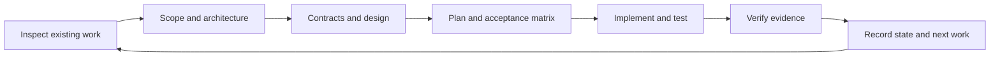

# SDD Stack

An experimental selection for specification-driven delivery. Maintainer: Equal Experts APM maintainers. The [selection](sdd.json) combines `docs-first-delivery`, `sdd-prompts`, `test-driven-development`, `systematic-debugging` and `verification-before-completion`. Each package remains independently usable.

Choose the prompt matching the workstream's current stage. Reuse existing artifacts, satisfy actual review gates, implement small slices and compare observed behaviour with the agreed specification. Existing authorization is preserved; this stack does not grant deployment or external-write permissions.

This is a catalogue selection, not a native managed-stack manifest. Pin the provider revision for reproducibility and review all selected packages before installation. The docs-first skill records adaptation provenance and limitations; the existing TDD packages retain their upstream attribution. No source-project configuration, internal operational procedure or client-specific artifact is distributed.

Structural checks, audits and catalogue tests do not demonstrate that an assistant will execute every stage correctly. Cross-harness behaviour and production delivery remain unverified. Refer to the PR evidence for installation and browser checks actually performed.
