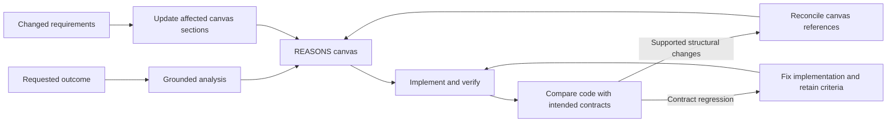

# SPDD Stack

An experimental selection for Structured Prompt-Driven Development, as described by Wei Zhang and Jessie Jie Xia in [the SPDD article](https://martinfowler.com/articles/structured-prompt-driven/). This pack maintains a REASONS canvas alongside implementation. It complements the existing [SDD Stack](sdd.md), which provides a broader docs-first delivery workflow and starting prompts; users do not need both stacks to use SPDD.

Stewardship: Equal Experts APM maintainers; individual long-term ownership is unassigned. The [selection](spdd.json) contains nine independently usable skills:

| Skill | Use when |
| --- | --- |
| [Parallel Stage Orchestration](../../.apm/skills/parallel-stage-orchestration/SKILL.md) | Coordinate parent/child execution on supported runtimes, with sequential fallback. |
| [SPDD Analysis](../../.apm/skills/spdd-analysis/SKILL.md) | Ground a requirement in the actual code, domain and constraints. |
| [SPDD REASONS Canvas](../../.apm/skills/spdd-reasons-canvas/SKILL.md) | Define Requirements, Entities, Approach, Structure, Operations, Norms and Safeguards. |
| [SPDD Implementation](../../.apm/skills/spdd-generate/SKILL.md) | Implement the current canvas with traceable acceptance evidence. |
| [SPDD Prompt Update](../../.apm/skills/spdd-prompt-update/SKILL.md) | Change the specification in response to authorized intent changes. |
| [SPDD Code-to-Spec Sync](../../.apm/skills/spdd-sync/SKILL.md) | Reconcile observed code changes without approving regressions. |
| [Test-driven development](../../.apm/skills/test-driven-development/SKILL.md) | Establish failing behavioural checks before implementation where appropriate. |
| [Systematic debugging](../../.apm/skills/systematic-debugging/SKILL.md) | Investigate unexpected behaviour and failing checks. |
| [Verification before completion](../../.apm/skills/verification-before-completion/SKILL.md) | Match completion claims to observed evidence. |

Start at the stage appropriate to the work already completed. A requirement change flows into the canvas before dependent implementation; a refactor flows back into structural references. A defect in code is not permission to change a valid requirement. Actual user authorization and repository review gates govern progression, not the diagram.

For parallel execution, the parent tracks stage dependencies and accepted input revisions. Children can explore independent areas, propose canvas sections, implement independent operations or verify a fixed revision concurrently. One owner integrates a canonical canvas; dependent stages wait for accepted inputs, and the parent tests combined changes. Nested delegation is conditional on runtime support and limits. See [platform capabilities](../../.apm/skills/parallel-stage-orchestration/references/platforms.md) for documented mechanisms and evidence boundaries.

## Sources and adaptation

The five SPDD skills adapt the five core command templates in [OpenSPDD at revision 3991ffa2cd6670fdb6f329ca62799ccb96d0e7d9](https://github.com/gszhangwei/open-spdd/tree/3991ffa2cd6670fdb6f329ca62799ccb96d0e7d9/internal/templates/data/core), inspected on 2026-11-15. Each package contains its own source attribution, adaptation notes and upstream MIT licence. The article provides method context and is linked rather than reproduced. The three existing supporting skills retain their Superpowers attribution and licence.

These sources were selected because the article directly links the method author's implementation and that repository provides licensed, inspectable templates. No claim of Thoughtworks endorsement, comparative benchmark superiority or independent security certification is made. Optional upstream commands, installers and binaries are not bundled. Additional tools can be evaluated separately if needed.

## Distribution and boundaries

This is a catalogue selection, not a native managed-stack manifest. Pages expands it into nine package installation commands; shared packages are deduplicated when multiple packs are selected. Review selected packages and pin the provider revision for reproducibility. There is no dependency on the upstream CLI or a harness-specific slash-command system.

Use the chosen assistant's supported skill invocation mechanism; OpenAI metadata includes each `$spdd-*` identifier. Installation and model execution across harnesses remain unverified for these adaptations. The text requires authorized project context and existing project tools, not a root consumer manifest in this provider.

See [review scenarios](spdd-review.md) for manual decision-boundary review. Structural checks and a working catalogue do not prove successful application delivery. This stack does not authorize external writes, publication or deployment.
