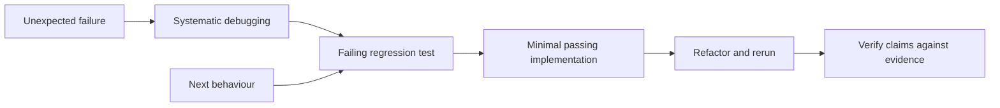

# TDD Stack

A named selection of three independently usable skills: test-driven-development for red-green-refactor, systematic-debugging for investigating failures, and verification-before-completion for evidence-based reporting. Maintainer: Equal Experts APM maintainers. Tier: experimental.

The selection in [tdd.json](tdd.json) uses the package versions from the same provider checkout. Pin the provider revision when reproducing an installation; this selection is not a native managed-stack installer. Review all three packages before installing. No planning, delegation, browser tooling or framework package is implicitly installed.

Upstream source is OpenAI's hosted Superpowers plugin at `0722921d5542fc593105c27bd52630babd8b8c2a`, with MIT attribution to Jesse Vincent retained per package. These are APM adaptations, not an official OpenAI TDD stack. Each skill records its source, dependencies and limitations in references/provenance.md. Use the consuming project's existing test and diagnostic tools. Cross-harness installation and behavioural evaluation remain unverified.

The debugging workflow helps identify the behaviour to test; verification checks that completion claims match the observed results.
