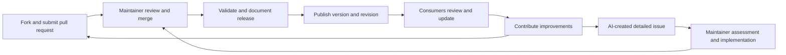

# Releases and support

APM is in its foundation stage. There are no published releases yet. Work on `master` is evolving and should not be treated as a supported release.

Before publishing a release, maintainers should identify its version and immutable source revision, document the included capabilities and compatibility, record verification and known limitations, and publish release notes. Consumers should pin a specific release or revision and review changes before updating. Forks and installed copies do not update automatically.

The supported release window, fix and backport policy, and response commitments require maintainer decisions. No support duration or response deadline is promised until those decisions are published.

Contributors submit changes through forked pull requests or detailed AI-created issues. Maintainers assess issues and implement accepted work; changes are reviewed upstream before release. Consumers choose when to adopt a published revision.
